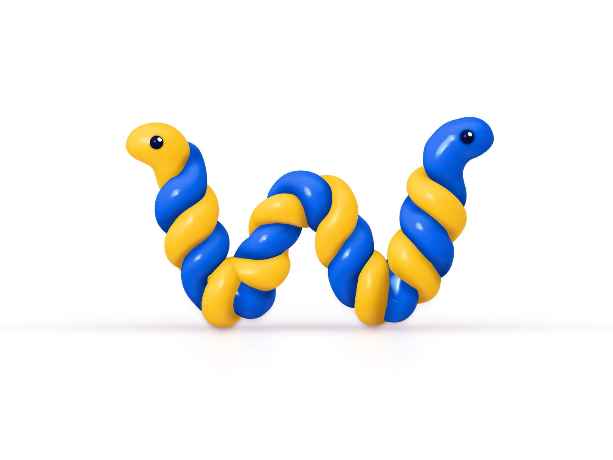
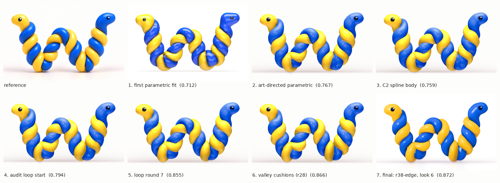

# Snake W: a Three.js reconstruction of the logo

An experiment, not the logo itself. wend's official logo is the original image-generated artwork,
`assets/logo.png` at the repository root. This project rebuilds that artwork procedurally: two
snakes, one blue and one yellow, twisted into a W, built to match the image (copied here as
`snakes/ref/reference.png`) at its own camera. It is kept for future development.

How it got there, from the first parametric fit to the final geometry and look:

- `final/progress.mp4` (31 s) shows all 38 milestones, each beside the reference. A running
  chart tracks the colour overlap with the reference: the mean IoU of the blue and yellow regions.
- `docs/journal/2026-10-20-snake-w-experiment-86.md` is the technical retrospective.

## View it

    cd experiments/snake-w/snakes && python3 -m http.server 8000    # http://localhost:8000/

Three.js r170 loads from jsdelivr (pinned). The page builds in about 3 s and keeps the reference
framing at any window size. `?params=`, `?spec=`, `?extra=`, `?look=` and `?heads=` point at other
files; `?heads=none` meshes the heads in the page (about 25 s).

## Files

- `snakes/index.html`: the page.
- `snakes/scene.js`: lights, materials, eyes, the floor shadow, and the overlay meshes (`extra`).
- `snakes/geometry.js`: tubes, heads and necks, and the surface corrections (fold, press, sections).
- `snakes/strandspline.js`: evaluates the body, a C2 cubic B-spline centreline and radius per strand.
- `snakes/w-final.params.json`: the parametric model: camera, heads, necks, tube options.
- `snakes/w-final.spec.json`: the body, a spline per strand.
- `snakes/w-final.extra.json`: both valleys' overlay. The tube is cut out over each valley and
  replaced by a mesh moved onto fitted implicit cushions.
- `snakes/w-final.look.json`: the look (lighting, material, colour).
- `snakes/heads-w-final.json`: the head meshes, baked for this body.

## Re-bake and render

Run these from `snakes/`. They need Node with Playwright and a Chromium (`$CHROME`, or the
pre-installed one). To work offline, put `three.module.js` r170 in `vendor/`, next to `tools/`.

    node ../tools/bake_heads.mjs w-final.params.json heads-w-final.json w-final.spec.json
    node ../tools/check_page.mjs index.html ../final/final.png 1448 1086

A bake is keyed by the parameters the heads depend on. If those change, the page meshes the heads
itself and logs a warning, so re-bake after editing the necks or heads.

## The fitting tools

The fitting, measuring and judging machinery is not in this tree. That covers the JAX soft raster
and region fits, the audit registry and evaluator, the autonomous correction loop, the implicit
cushions, look fitting and the advisory geometry diagnosis. It is archived on the branch
[`archive/logo-snake-w-research`](https://github.com/lmmx/wend/tree/archive/logo-snake-w-research)
(commit `4a40bcf`, the last full commit of [PR #86](https://github.com/lmmx/wend/pull/86)), with
every round's specs, judgements and sheets.
